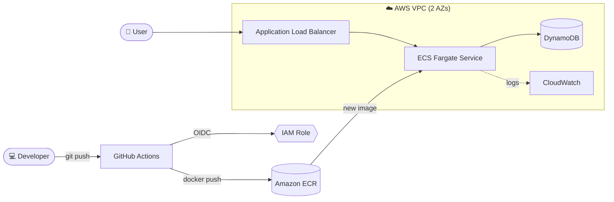

<div align="center">

# ✅ Todo App on AWS
### Push code → GitHub Actions → ECS Fargate → Live. 🚀


**A full-stack Todo app, provisioned with Terraform and shipped automatically on every push.**

[Architecture](#-architecture) • [Pipeline](#-how-a-push-becomes-production) • [Security](#-security) • [Quick Start](#-quick-start) • [Structure](#-project-structure)

</div>

---

## 🎯 What's This?

A production-style DevOps project showing how to take an app from `git push` to a running, load-balanced container on AWS, with **zero long-lived AWS keys**.

| Layer | Tech |
|---|---|
| 🎨 Frontend | React |
| ⚙️ Backend | Node.js + Express |
| 🗄️ Database | Amazon DynamoDB |
| 📦 Containers | Docker → Amazon ECR |
| 🏃 Compute | ECS Fargate behind an ALB |
| 🏗️ Infra | Terraform |
| 🤖 CI/CD | GitHub Actions + OIDC |
| 📈 Logs | CloudWatch |

---

## 🏗️ Architecture



<details>
<summary><b>🔍 Click to see everything Terraform creates</b></summary>

- **Networking:** VPC, public subnets in 2 AZs, internet-facing ALB, security groups
- **Compute:** ECS cluster, Fargate service, task definition, ECR repository
- **Data & Monitoring:** DynamoDB table, CloudWatch log groups
- **IAM:** task execution role, task role, GitHub OIDC provider, GitHub deploy role

</details>

---

## 🔄 How a Push Becomes Production

```text
 💻 git push  →  🤖 Actions  →  🐳 Build  →  🔑 OIDC Login  →  📦 Push to ECR  →  🚀 ECS Update  →  📈 Logs
```

<details>
<summary><b>👉 Step-by-step breakdown</b></summary>

1. **Push** code to `main`
2. **Checkout** the latest source
3. **Build** the Docker image
4. **Authenticate** to AWS via OIDC (no stored secrets)
5. **Push** the image to Amazon ECR
6. **Update** the ECS service with the new task definition
7. **Run** the fresh containers on Fargate
8. **Observe** logs in CloudWatch

</details>

---

## 🔐 Security

- 🔑 **OIDC, not access keys**: GitHub Actions gets short-lived credentials
- 🎭 **Separate IAM roles** for ECS execution, app runtime, and CI/CD
- 🗄️ **Task role** allows only the DynamoDB actions the app needs
- 🛡️ **Security groups** limit inbound traffic
- ✂️ **Least privilege** across every policy

---

## ⚡ Quick Start

<details open>
<summary><b>🧰 Prerequisites</b></summary>

- [ ] AWS account + AWS CLI
- [ ] Terraform
- [ ] Docker
- [ ] Node.js & npm
- [ ] Git + GitHub account

</details>

<details>
<summary><b>1️⃣ Clone</b></summary>

```bash
git clone https://github.com/YOUR_GITHUB_USERNAME/todo-node-aws.git
cd todo-node-aws
```

</details>

<details>
<summary><b>2️⃣ Provision AWS infrastructure</b></summary>

```bash
cd terraform
terraform init
terraform validate
terraform plan
terraform apply   # review the plan before approving!
```

</details>

<details>
<summary><b>3️⃣ Wire up GitHub Actions</b></summary>

- Set the OIDC trust to your **GitHub username/org and repo name**
- Add the required repository variables and permissions for the workflow

</details>

<details>
<summary><b>4️⃣ Ship it</b></summary>

```bash
git add .
git commit -m "Deploy Todo application"
git push origin main
```

Watch the **Actions** tab, then open the ALB URL from `terraform output`. 🎉

</details>

---

## 📁 Project Structure

```text
todo-node-aws/
├── frontend/            # React app
├── backend/             # Express API
├── terraform/           # vpc, ecs, ecr, alb, iam, dynamodb ...
├── .github/workflows/   # deploy.yml (CI/CD)
├── Dockerfile
└── README.md
```

> Filenames may vary slightly from the illustration above.

---

## 🧠 What You'll Learn

`Infrastructure as Code` · `Docker` · `CI/CD` · `ECS Fargate` · `ECR` · `OIDC auth` · `IAM least privilege` · `ALB networking` · `CloudWatch logging`

---

<div align="center">

**Built with ❤️ using AWS, Terraform, Docker & GitHub Actions**

⭐ If this helped you, give the repo a star!

</div>
